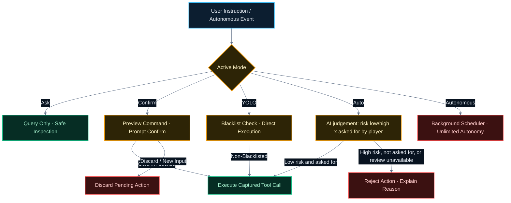

<div align="right">

**[English](README.md)** | [繁體中文](README.zh-TW.md)

</div>

<div align="center">

# RimAgent

**Run your RimWorld colony in natural language.**

An in-game AI agent mod for RimWorld 1.6 featuring a draggable floating window (RimAgent), 51 colony management tools, multi-tier risk validation, and autonomous routine management.

**RimWorld 1.6** &nbsp;·&nbsp; **51 Tools** &nbsp;·&nbsp; **Autonomous & Auto Modes** &nbsp;·&nbsp; **MCP Extensible**

[](#prerequisites)
[](https://github.com/mushroomTW/RimLLM-Framework)
[](#building)

</div>

---

## Getting Started

### Prerequisites

- **RimWorld 1.6**
- **[RimLLM Framework](https://github.com/mushroomTW/RimLLM-Framework)** (version **2026.09.12 or later**, required for native tool calling)
- Mod load order: `RimAgent` must be placed and loaded **after** `RimLLM Framework`.

> [!IMPORTANT]
> All LLM plumbing (provider selection, API key, model selection, fallback chains, and token budget) is configured in **RimLLM Framework**. RimAgent adds colony tools and per-category tool permissions.

### Quick Start

1. Subscribe to and enable both **RimLLM Framework** and **RimAgent** in your RimWorld mod manager.
2. In RimWorld's **Mod Settings &gt; RimLLM Framework**, configure your preferred LLM provider (OpenAI, Anthropic Claude, Google Gemini, Ollama, etc.) and enter your API key.
3. Load or start a game. Click the **Agent** button (with the RimAgent icon) on the bottom navigation bar to open the floating window (RimAgent).
4. Type what you want done into the prompt line, for example:
   - `"set Alice's Doctor priority to 1"`
   - `"mark the steel in the selected area for mining"`
   - `"draft everyone and move to (25, 30)"`
5. Press **Send** (or Enter). The agent inspects colony state through tools, plans actions, and executes real game commands in real time without closing the world view.

---

## Highlights

<table>
  <tr>
    <td align="center" width="33%">
      <h3>🧠 Natural Language</h3>
      <sub>Speak naturally to assign work, place blueprints, order retreats, and manage trade without navigating menus.</sub>
    </td>
    <td align="center" width="33%">
      <h3>🛡️ Five-Tier Safety</h3>
      <sub>Ask (read-only), Confirm (every command), YOLO (blacklist direct), Auto (safety review), and Autonomous.</sub>
    </td>
    <td align="center" width="33%">
      <h3>⏱️ Autonomous Routine</h3>
      <sub>Scheduled periodic inspections and instant triggers for raids, mental break alerts, food shortages, injuries, and fire.</sub>
    </td>
  </tr>
  <tr>
    <td align="center" width="33%">
      <h3>📊 51 Colony Tools</h3>
      <sub>Covers observation, work priorities, construction, combat, trading, medical care, animals, prisoners, and zones.</sub>
    </td>
    <td align="center" width="33%">
      <h3>🔌 Local MCP Support</h3>
      <sub>Connect local Model Context Protocol servers to grant the agent external data and tooling.</sub>
    </td>
    <td align="center" width="33%">
      <h3>💾 Full Save Persistence</h3>
      <sub>Visible transcript, compacted model session, scheduler state, and <code>/undo</code> history are saved with your game.</sub>
    </td>
  </tr>
</table>

---

## Window Interface & Slash Commands

The RimAgent window can be moved anywhere on screen with position and size memory. It includes:

- **Action Log Stream**: Real-time record with distinct Player, Agent, and Tool labels. Tool arguments, safety-review status, and results appear on separate lines. Screenshots taken by the agent show an inline preview beneath the tool result. The trailing ellipsis animates (`.` → `..` → `...`) while running.
- **Status Dropdowns**: Configure execution **mode** (Ask / Confirm / YOLO / Auto / Autonomous) and model **reasoning effort** (Auto / Off / Low / Medium / High).
- **Control Bar**: Input field with **Send** (which switches to **Stop** while the agent is running).
- **Title-Bar Token Readout**: Shows the actual input tokens reported for the most recent main-model request. It says unavailable when the provider omits usage data. Hover for model-history message count and the auto-fold threshold; the token count is not a model context-window limit.
- **Resizable Window**: Drag the lower-right corner to resize the conversation, including screenshot previews. Size and position are saved between sessions.
- **Slash Commands**: Type `/` to open the command completion list (↑↓ to navigate, Tab or Enter to select):

| Command | Description |
| --- | --- |
| `/goal <text>` | Queue a persistent goal; it starts immediately and continues across turns in any Agent mode, using that mode's command policy |
| `/goal` | List queued goals and the active goal's status |
| `/goal remove <n>` | Delete goal `n` |
| `/goal pause` / `/goal resume` | Pause or resume persistent goal execution |
| `/undo` | Restore the work priorities and schedules modified by the last instruction |
| `/clear` | Clear the visible conversation transcript |
| `/compact` | Compact context: summarize older model history with one LLM call, keeping only recent turns (visible log kept) |
| `/stop` | Immediately abort the currently running instruction |

> **Context compaction**: when model history exceeds the threshold (default 60 messages), older tool output is folded automatically before each request at no extra model cost. Once stored history reaches twice the threshold, the oldest complete turns are dropped until it is back within the threshold, so saves and loads stay small (the visible log is unaffected). The switch and threshold live in mod settings. `/compact` triggers a deeper manual summary compression at any time.

> **Run history**: Enable **Record Agent runs** in mod settings to write a separate JSONL file at `RimWorld save data/RimAgent/RimAgent-runs.jsonl`. It records instructions, model response summaries, tool arguments/results, safety decisions and outcomes. It is off by default and keeps at most 500 runs or 16 MiB, whichever limit comes first.

> **Prompts are editable**: `Briefing.md`, `Conduct.md`, `AskMode.md`, `RiskClassifier.md`, `Autonomous.en.md` and `Skills/` under `AgentPack/` are plain-text prompts — edit, save, and the next instruction picks them up, no rebuild needed. `AGENTS.md` ships empty and is yours: write anything you want the agent to always honor.

---

## Modes & Safety

One setting decides how much the agent may do on its own:

| Mode | Behavior |
| --- | --- |
| **Ask** | **Read-only**. Only query tools are offered to the model; state-changing tools (including map switching and screenshots) are omitted so the agent inspects and advises without side effects. |
| **Confirm** | **Every command requires confirmation**. Any state-changing action is previewed and pauses for player **Confirm**; safe queries run directly. |
| **YOLO** | Positioned between Confirm and Auto, **no scheduler**. Protected by a blacklist (high-risk tools like trade, caravans, surgery excluded); all other permitted commands and MCP execute directly without confirmation. |
| **Auto** | Every command is previewed first, then a secondary model reviews it on **two axes** (including MCP tools): risk (`low` / `high`) and whether the player's instruction asked for it. **Only low-risk, authorized actions execute**. High-risk or unrequested actions are rejected with a reason, without a player confirmation prompt. Classifier failures also reject the action. The classifier model is configurable in mod settings (leave blank to inherit default). |
| **Autonomous** | **Background scheduler autonomy**: Runs routine inspections and responds to colony emergencies automatically without blacklist restrictions, without a daily tool budget limit, and with direct MCP execution. Cooldown is configurable in settings (default disabled). |

### Decision & Safety Flow



### Safety Guarantees

- **Confirm / Discard**: Clicking **Confirm** executes the exact captured tool call and arguments from the preview; it never re-queries the model, preventing already-safe actions from repeating. A new instruction or clicking Discard drops all pending calls.
- **YOLO Mode**: Runs player instructions directly without confirmation while safeguarding high-risk operations via an explicit blacklist.
- **Autonomous Mode**: Full unattended background operation without blacklist or budget restrictions, with configurable cooldown (default disabled).
- **Always allow (this session)**: In Confirm mode, the confirm bar offers **Always allow** for eligible tools. It remembers tool names only, is never written to the save, and is reset by `/clear` or a restart. Auto mode reviews every command independently, even if that tool was previously allowed in Confirm mode. `mcp_call_tool` and the blacklisted high-risk tools (`execute_trade`, `form_caravan`, `release_prisoner`, `schedule_surgery`, `set_prisoner_interaction`) never offer Always allow.
- **MCP Confirmation**: In Confirm mode, `mcp_call_tool` requires explicit player confirmation; in Auto mode, the classifier either permits or rejects it without a confirmation prompt; in YOLO and Autonomous modes, it executes directly.
- **Configurable Risk Classifier**: In Auto mode, the dedicated classifier model can be customized in mod settings (e.g. specifying a fast/cheap model like `gpt-4o-mini` or `gemini-1.5-flash`), or left blank to inherit RimLLM Framework's default model.
- **Reversible Priorities (`/undo`)**: Restores work priorities and daily schedules modified by the previous instruction, including instructions that failed halfway through.
- **Readiness Guard**: If no game is being played (main menu or save still loading) or no current map is available, tool execution halts safely and instructs the model to stop.
- **Game Error Feedback**: Errors logged by the game engine (`Log.Error`) during tool execution are appended to that tool's result (up to 5 errors with count), alerting the model if a command threw an exception.
- **In-Tool Guard Rails**: `order_attack` refuses colony members, prisoners, and friendly factions; `order_job` refuses captures and strips that would anger a non-hostile faction and leaves persona-weapon bonding to the player; `set_forbidden` only touches items and corpses outside the fog; `use_gizmo` only presses action and toggle buttons, hides developer-mode buttons, and closes any menu or window it cannot operate instead of leaving it open; `schedule_surgery` requires an explicit body part; `execute_trade` requires a conscious, socially capable negotiator and a powered comms console for orbital traders; `form_caravan` departs immediately without packing delays; zones validate against terrain, map boundaries, and fertility.

> [!WARNING]
> Combat orders reach the game several seconds after speaking due to LLM round-trip latency. They are designed for strategic positioning, rally points, and tactical retreats, not split-second micro-control.

> [!CAUTION]
> MCP servers run as local processes with your user operating system privileges. Only enable local MCP servers that you trust.

---

## Autonomy (Autonomous Mode)

Select **Autonomous** mode (in Mod Settings or the mode dropdown) to enable the agent to run unattended background operations:

- **Periodic Inspection**: Routine colony checks run on a configurable interval (default: 6 in-game hours).
- **Event-Driven Reactive Runs**: Instant edge-triggered responses to:
  - Raid beginnings and ends
  - Colonists nearing mental breaks
  - Food shortages
  - Downed or bleeding colonists (medical emergency)
  - Active fires on any colony map
  - New choice letters or dialogs (a wanderer asking to join, refugees, ransom demands). Checked every 2 real-time seconds, even while a dialog pauses the game; each choice triggers once
- **Unlimited Budget & Cooldown Control**: Autonomous runs have no daily tool-call budget restriction. A configurable cooldown (0–60 minutes in mod settings, default: disabled) prevents runs from re-triggering too rapidly.
- **Persistent Goals**: `/goal` runs independently of Autonomous mode. The first queued objective starts shortly after creation, is repeated in each continuation after context compaction, and continues until verified complete. It waits for confirmations required by the current mode and passes confirmed execution results into the next continuation. Goal pause/removal only discards confirmations raised by that goal. Three blocked/error turns or 60 turns pause it for review; `/goal resume` restarts it. Goals are saved with the game.

---

## What It Can Do

| Category | Tools | Default |
| --- | --- | --- |
| Observe | colony overview, colonists, resources, threats, research status and switching, map listing and switching (safe command), map object search, cell and area inspection (terrain, roof, rooms, zones, obstacles), game screenshots (safe command), pending choice letters, dialogs and confirmation boxes and answering them (confirm command) | on |
| Work | work priorities, daily schedules (undoable) | on |
| Build | mine / cut / harvest / deconstruct / haul / hunt designations, blueprints (single, line, filled rectangle or rectangle outline, up to 400 cells per call), forbidding and allowing items, command buttons (gizmos) such as ship reactor startup and ship launch (pressing is a confirm command) | on |
| Combat | draft, move, attack, one-off jobs (rescue, capture, tend, strip, equip, enter a cryptosleep casket) | on |
| Trade | orbital trader and visiting caravan stock listing, buying and selling in a single deal, forming player caravans | on |
| Medical | health status, medical care levels, scheduling surgery | on |
| Prisoner | prisoner listing, interaction modes, release | on |
| Animal | animal listing, taming, training, allowed areas | on |
| Zone | zone listing, stockpile and growing zones, storage filters | on |
| Production | work tables and production bills | on |
| Time | pause and time flow speed | on |
| MCP | external tools from local MCP servers | on |

### Tool Reference

Every tool by name, with its category and static risk tag. The block between the markers is verified against the registry by `ReadmeToolTableTests`:

<!-- tool-table:begin -->
| Tool | Category | Risk |
| --- | --- | --- |
| `choose_option` | Observe | Confirm |
| `find_things` | Observe | Query |
| `get_colonist_wellbeing` | Observe | Query |
| `get_colony_overview` | Observe | Query |
| `get_maps` | Observe | Query |
| `get_research_status` | Observe | Query |
| `get_resources` | Observe | Query |
| `inspect_area` | Observe | Query |
| `list_colonists` | Observe | Query |
| `list_pending_choices` | Observe | Query |
| `list_recent_letters` | Observe | Query |
| `list_threats` | Observe | Query |
| `set_current_map` | Observe | Safe |
| `set_research` | Observe | Safe |
| `take_screenshot` | Observe | Safe |
| `list_work_priorities` | Work | Query |
| `set_schedule` | Work | Safe |
| `set_work_priorities` | Work | Safe |
| `cancel_designation` | Build | Safe |
| `designate_area` | Build | Confirm |
| `list_gizmos` | Build | Query |
| `place_blueprint` | Build | Confirm |
| `set_forbidden` | Build | Safe |
| `use_gizmo` | Build | Confirm |
| `draft` | Combat | Safe |
| `order_attack` | Combat | Confirm |
| `order_job` | Combat | Safe |
| `order_move` | Combat | Safe |
| `execute_trade` | Trade | Confirm |
| `form_caravan` | Trade | Confirm |
| `list_traders` | Trade | Query |
| `get_health` | Medical | Query |
| `schedule_surgery` | Medical | Confirm |
| `set_medical_care` | Medical | Safe |
| `list_prisoners` | Prisoner | Query |
| `release_prisoner` | Prisoner | Confirm |
| `set_prisoner_interaction` | Prisoner | Confirm |
| `list_animals` | Animal | Query |
| `set_animal_area` | Animal | Safe |
| `tame_animal` | Animal | Safe |
| `train_animal` | Animal | Safe |
| `add_zone` | Zone | Safe |
| `delete_zone` | Zone | Confirm |
| `list_zones` | Zone | Query |
| `set_zone_filter` | Zone | Safe |
| `add_bill` | Production | Safe |
| `delete_bill` | Production | Confirm |
| `list_bills` | Production | Query |
| `set_time_speed` | Time | Safe |
| `mcp_call_tool` | Mcp | Confirm |
| `mcp_list_tools` | Mcp | Query |
<!-- tool-table:end -->

---

## How It Works

```text
player text ──► ColonyAgentSession ──► ChatClientAgent (Microsoft Agent Framework)
         │                                    │ single GetResponseAsync, history in AF session
         │                                    ▼
         │                              FunctionInvokingChatClient (MEAI, via RimLLM Framework's main-thread wrapper)
         │                                    │ tool calls
         │                                    ▼
         │                              51 tools (AIFunctionFactory) ──► IGameWorld ──► RimWorldGameWorld ──► Verse / RimWorld API
         │
         └─► system prompt via ChatOptions.Instructions (CachedContext left empty, pending token measurement)
```

Two architectural seams keep RimAgent testable without running RimWorld:

- **`IChatClient`**: The agent accepts any `Microsoft.Extensions.AI` chat client. Unit tests run with scripted fakes without network or LLM tokens.
- **`IGameWorld`**: Tools interact only with plain data transfer objects and interfaces. Unit tests execute against an in-memory fake world. `RimWorldGameWorld` is a thin adapter verified in-game.

UI strings (`Languages/` Keyed) and the Agent main-button label (`Languages/` DefInjected) are localized in English, Traditional Chinese, and Simplified Chinese.

---

## Building

```bash
dotnet build "Source/RimAgent/RimAgent.csproj" -c Release
```

Release compilation writes `Assemblies/RimAgent.dll` plus the 12 standalone assemblies required by the mod that are not provided by the base game or framework:

- **10 Agent Framework Assemblies**: `Microsoft.Agents.AI`, `Microsoft.Agents.AI.Abstractions`, `Microsoft.Extensions.Compliance.Abstractions`, `Microsoft.Extensions.ObjectPool`, `Microsoft.Extensions.VectorData.Abstractions`, `Microsoft.Extensions.FileSystemGlobbing`, `Microsoft.Bcl.Memory`, `Microsoft.Bcl.HashCode`, `Microsoft.ML.Tokenizers`, `Google.Protobuf`.
- **2 MCP SDK Assemblies**: `ModelContextProtocol.Core`, `System.Collections.Immutable`.

RimWorld scans assemblies on startup with `Assembly.GetTypes()` and `GetFields()`, requiring all base and referenced field types to resolve cleanly. The project references RimLLM Framework assemblies from `../RimLLM Framework/Assemblies` (override with `/p:RimLLMDir=<path>` if installed elsewhere).

---

## Tests

```bash
dotnet test "Source/RimAgent.Tests/RimAgent.Tests.csproj"
```

The test suite runs with NUnit on .NET Framework 4.7.2 with zero game dependencies. All tool executions, preview branches, transcript persistence, risk classifications, and documentation tool tables are validated automatically.

---

This project is licensed under the [MIT License](LICENSE).
