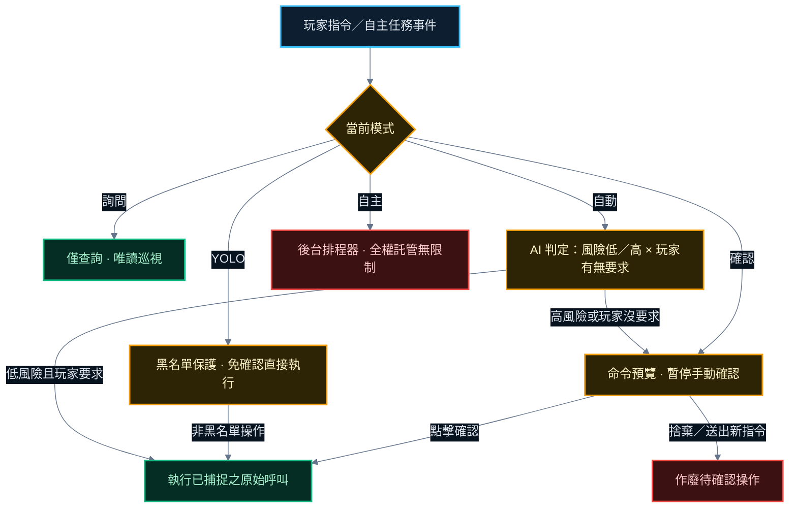

<div align="right">

[English](README.md) | **[繁體中文](README.zh-TW.md)**

</div>

<div align="center">

# RimAgent

**以自然語言管理你的 RimWorld 殖民地。**

專為 RimWorld 1.6 設計的遊戲內 AI 助手模組，具備可自由拖曳的懸浮視窗（RimAgent）、53 項殖民地管理工具、多層級風險把關機制，以及自主巡檢營運能力。

**RimWorld 1.6** &nbsp;·&nbsp; **53 項工具** &nbsp;·&nbsp; **自動／自主模式** &nbsp;·&nbsp; **支援 MCP 擴充**

[](#先決條件)
[](https://github.com/mushroomTW/RimLLM-Framework)
[](#建置)

</div>

---

## 快速上手

### 先決條件

- **RimWorld 1.6**
- **[RimLLM Framework](https://github.com/mushroomTW/RimLLM-Framework)**（版本需求 **2026.09.12 或更高**，以支援原生工具呼叫）
- 模組載入順序：`RimAgent` 必須排列於 `RimLLM Framework` **之後**載入。

> [!IMPORTANT]
> 所有底層大型語言模型（LLM）連線配置（API 供應商、金鑰、模型挑選、備援鏈與 Token 預算）皆在 **RimLLM Framework** 模組設定中管理。RimAgent 專注於提供殖民地操作工具與類別權限開關。

### 入門步驟

1. 在 RimWorld 模組管理器中訂閱並啟用 **RimLLM Framework** 與 **RimAgent**。
2. 進入 RimWorld **選項 &gt; 模組設定 &gt; RimLLM Framework**，設定你慣用的 LLM 供應商（OpenAI、Anthropic Claude、Google Gemini、本機 Ollama 等）並填入 API 金鑰。
3. 載入或開啟新遊戲，點擊底部導航列的 **Agent** 按鈕，即可開啟可移動的懸浮視窗（RimAgent）。
4. 在輸入列鍵入自然語言指令，例如：
   - `「將 Alice 的就醫優先級設為 1」`
   - `「開採框選區域內的鋼鐵」`
   - `「徵召所有人並移動到座標 (25, 30)」`
5. 按下 **發送**（或 Enter 鍵）。助手會透過查詢工具讀取殖民地現況、規劃動作，並在不中斷世界視圖的情況下即時執行遊戲命令。

---

## 功能亮點

<table>
  <tr>
    <td align="center" width="33%">
      <h3>🧠 自然語言調度</h3>
      <sub>直接以文字指派工作、佈置建築藍圖、指揮戰鬥撤退與交易買賣，無需層層翻找介面選單。</sub>
    </td>
    <td align="center" width="33%">
      <h3>🛡️ 五重安全防護</h3>
      <sub>支援詢問（唯讀）、確認（每條指令確認）、YOLO（黑名單直接執行）、自動（AI 風險分類器）與自主模式。</sub>
    </td>
    <td align="center" width="33%">
      <h3>⏱️ 自主巡檢常規</h3>
      <sub>可設定週期性例行巡檢，並在襲擊發生、精神崩潰警報、缺糧、流血受傷與火災時即時反應。</sub>
    </td>
  </tr>
  <tr>
    <td align="center" width="33%">
      <h3>📊 53 項殖民地工具</h3>
      <sub>涵蓋狀態觀察、工作排程、建造標記、戰鬥指令、商業交易、醫療照護、動物馴養與區域管理。</sub>
    </td>
    <td align="center" width="33%">
      <h3>🔌 本機 MCP 支援</h3>
      <sub>可串接官方 Model Context Protocol 伺服器，賦予助手擴充外部資料與工具之能力。</sub>
    </td>
    <td align="center" width="33%">
      <h3>💾 隨存檔完整保存</h3>
      <sub>可見對話、壓縮後的模型上下文、排程器狀態與 <code>/undo</code> 工作復原堆疊皆隨遊戲存檔持久化保存。</sub>
    </td>
  </tr>
</table>

---

## 視窗介面與斜線指令

RimAgent 視窗可於螢幕上任意拖曳擺放，並自動記憶視窗位置與尺寸。面板包含：

- **行動紀錄串流**：即時呈現玩家指令、工具呼叫過程與助手最終回覆。執行中後方省略號有 `.` → `..` → `...` 循環動畫。
- **狀態下拉選單**：即時調整執行**模式**（詢問／確認／YOLO／自動／自主）與模型**推理強度**（自動／關閉／低／中／高）。
- **控制列**：單行文字輸入框與**發送**按鈕（助手執行期間切換為**停止**按鈕）。
- **標題列上下文計量**：右上角即時顯示模型歷史則數／自動壓縮門檻（`上下文 N/M`），接近門檻變黃、達到變紅。
- **斜線指令**：輸入 `/` 即可叫出自動補齊列表（↑↓ 選擇，Tab 或 Enter 確認）：

| 指令 | 說明 |
| --- | --- |
| `/goal <內容>` | 新增殖民地長期目標（自主任務會持續推進，並隨存檔儲存） |
| `/goal` | 列出目前對話中的所有長期目標 |
| `/goal remove <序號>` | 刪除指定序號的目標 |
| `/undo` | 復原上一句指令所變更的工作優先級與作息時間表 |
| `/clear` | 清空當前可見的對話紀錄 |
| `/compact` | 壓縮上下文：用一次 LLM 摘要折疊較舊的模型歷史，只保留最近幾輪（可見紀錄保留） |
| `/stop` | 立即中斷當前正在執行的指令 |

> **上下文壓縮**：模型歷史超過門檻（預設 60 則）時，每次請求前自動折疊較舊的工具輸出，不多花模型呼叫；存下的歷史達門檻兩倍時，從最舊的完整對話輪開始捨棄、裁回門檻以內，存讀檔不會隨遊戲時長越來越慢（可見對話紀錄不受影響）。開關與門檻在 mod 設定頁調整。`/compact` 則隨時手動做一次深度摘要壓縮。

> **提示詞可改**：`AgentPack/` 底下的 `Briefing.md`（前情提要）、`Conduct.md`、`AskMode.md`、`RiskClassifier.md`、`Autonomous.en.md` 與 `Skills/` 都是純文字提示詞，改完存檔、下一句指令生效，不必重編譯。`AGENTS.md` 出貨是空的，留給你寫想交代 agent 的事。

---

## 模式與安全機制

透過單一模式設定，即可決定助手能自行操作的授權範圍：

| 模式 | 行為說明 |
| --- | --- |
| **詢問** | **唯讀狀態**。僅提供查詢工具給模型；任何會改變遊戲狀態的操作（包含切換地圖與截圖）皆不載入，讓助手安全提供決策建議。 |
| **確認** | **每個指令都需要確認**。任何會改變遊戲狀態的操作皆先回傳預覽，等待玩家點擊**確認**；安全查詢則直接執行。 |
| **YOLO** | 夾在確認與自動之間，**無排程器**。受黑名單保護（交易、商隊、手術、囚犯等高危工具排除），其餘所有許可命令與 MCP 工具免確認直接執行。 |
| **自動** | 每個命令執行前會先取得預覽，並另起一次不帶工具的模型呼叫做**兩軸判定**（包含 MCP 工具）：動作本身的風險（低／高），以及玩家這句話有沒有明確要求這個動作。**只有「低風險且玩家明確要求」才直接放行**，其餘（高風險、或玩家沒要求的順手操作）一律進入**確認**流程。判定失敗一律視為高風險。分類器模型可在模組設定中自訂（留空則沿用框架預設）。 |
| **自主** | **後台排程器自主運轉**：依排程週期與突發事件自動巡檢並即時反應，不限制任何行為（無黑名單限制），不設每日工具預算上限，MCP 免確認直接執行。自主任務冷卻時間可在設定中調整（預設關閉）。玩家仍可隨時下指令。 |

### 決策與安全把關流程



### 安全保證

- **確認與捨棄**：點擊**確認**會執行預覽階段捕捉到的確切工具呼叫與參數，**絕不重新將指令送交模型**，避免安全操作重複執行；送出新指令或點擊捨棄會立即清空待執行佇列。
- **本局不再問**：確認列另有「本局不再問」，按下後該工具在這場遊戲中不再要求確認（自動模式下也不再花一次呼叫問分類器）。只記工具名稱、不寫入存檔，`/clear` 或重開遊戲即歸零；`mcp_call_tool` 與黑名單上的高危工具（`execute_trade`、`form_caravan`、`release_prisoner`、`schedule_surgery`、`set_prisoner_interaction`）永遠不提供此選項——MCP 每次執行的外部程式都不同，黑名單的意思則是「絕不免確認執行」。
- **YOLO 模式**：回應玩家手動指令時免確認直接執行，同時透過明確黑名單排除交易、商隊、重大手術等高危操作。
- **自主模式**：後台無人值守運轉，不限制任何行為且不設預算上限，支援自訂冷卻時間（預設關閉）。
- **MCP 確認機制**：在「確認」模式下，`mcp_call_tool` 強制需要玩家手動批准；在「自動」模式下由雙層模型動態判定；在「YOLO」與「自主」模式下則免確認直接執行。
- **可自訂風險分類器模型**：在「自動」模式下，判定風險所使用的輕量模型可在模組設定中獨立指定（例如設定快速便宜的 `gpt-4o-mini` 或 `gemini-1.5-flash`），留空則自動沿用 RimLLM Framework 的全域預設模型。
- **工作優先級復原 (`/undo`)**：可一鍵將上一句指令變更的工作優先度與每日作息還原為舊值；即使指令中途失敗，已生效的部分亦能安全復原。
- **就緒狀態防護**：若遊戲處於主選單、存檔讀取中，或工具呼叫時無有效當前地圖，工具將拒絕執行並告知模型終止操作。
- **遊戲錯誤回流**：工具執行期間 RimWorld 核心所記錄的錯誤日誌（`Log.Error`，至多 5 則）會附加回傳於工具結果中，讓模型明確知悉執行失敗的內部原因。
- **工具內建防呆邊界**：`order_attack` 拒絕攻擊友方派系、殖民者與囚犯；`schedule_surgery` 要求指定確切身體部位；`execute_trade` 檢查交涉者社交能力與通訊台電力；`form_caravan` 採立即離圖機制；儲存與種植區建立前經由原生設計器驗證地勢與肥沃度。

> [!WARNING]
> 戰鬥指令受限於 LLM 往返處理時間，通常有數秒延遲。僅適用於戰略集結、防線佈置與撤退，不適合作為即時戰術微操。

> [!CAUTION]
> 本機 MCP 伺服器是以作業系統目前使用者的本機權限執行。請務必僅啟用與連線至你完全信任的 MCP 伺服器。

---

## 自主營運 (Autonomous Mode)

在模組設定或模式下拉選單切換至 **自主** 模式，助手將自動於背景巡視並守護殖民地：

- **常規例行巡檢**：依設定週期固定巡檢殖民地狀態（預設每 6 遊戲小時一次）。
- **突發事件觸發反應**：即時邊緣觸發並反應各類重大危機：
  - 襲擊開始與結束
  - 殖民者瀕臨精神崩潰
  - 糧食庫存告急
  - 殖民者倒地或失血急診
  - 任何地圖上的火災威脅
- **無預算限制與冷卻設定**：自主模式運轉不設每日工具預算上限，且支援自主任務冷卻時間設定（可在模組設定調整 0～60 分鐘，預設關閉），避免短時間內過度頻繁觸發。
- **長期目標推進**：玩家透過 `/goal` 設定的長期期望會附帶於每次自主任務的提示詞中，隨存檔共同保存並持續落實。

---

## 工具功能清單

| 類別 | 工具功能 | 預設狀態 |
| --- | --- | --- |
| 觀察 | 殖民地概況、殖民者、資源清單、威脅掃描、研究狀態與專案切換、地圖列出與切換、物件搜尋、格子與區域檢查（地形、屋頂、房間、區域、障礙物）、遊戲截圖 | 開啟 |
| 工作 | 工作優先度指派、每日作息時間表設定（支援復原） | 開啟 |
| 建造 | 開採／砍伐／收割／拆除／搬運／狩獵標記、單點或連線建築藍圖規劃 | 開啟 |
| 戰鬥 | 徵召、戰術移動、指定攻擊 | 開啟 |
| 交易 | 軌道商人與來訪商隊貨物查詢、一鍵買入與賣出結清、指派籌組外出商隊 | 開啟 |
| 醫療 | 殖民者健康狀態、用藥上限設定、手術排程 | 開啟 |
| 囚犯 | 囚犯清單、互動方針調整、直接釋放 | 開啟 |
| 動物 | 家畜清單、野獸馴養、技能訓練、允許區域指派 | 開啟 |
| 區域 | 區域清單、儲藏區與種植區新增／刪除、儲存篩選清單配置 | 開啟 |
| 生產 | 工作台設備查詢、生產帳單新增／刪除／重複次數管理 | 開啟 |
| 時間 | 時間暫停與時間流速切換 | 開啟 |
| MCP | 連接本機 MCP 伺服器外部工具 | 開啟 |

### 工具參考總表

所有工具名稱、對應類別與靜態風險等級標記。標記區間內容由單元測試 `ReadmeToolTableTests` 強制檢驗：

<!-- tool-table:begin -->
| Tool | Category | Risk |
| --- | --- | --- |
| `find_things` | Observe | Query |
| `get_cell_info` | Observe | Query |
| `get_colonist_wellbeing` | Observe | Query |
| `get_colony_overview` | Observe | Query |
| `get_maps` | Observe | Query |
| `get_power_status` | Observe | Query |
| `get_research_status` | Observe | Query |
| `get_resources` | Observe | Query |
| `inspect_area` | Observe | Query |
| `list_alerts` | Observe | Query |
| `list_colonists` | Observe | Query |
| `list_recent_letters` | Observe | Query |
| `list_threats` | Observe | Query |
| `set_current_map` | Observe | Safe |
| `set_research` | Observe | Safe |
| `take_screenshot` | Observe | Safe |
| `list_work_priorities` | Work | Query |
| `set_schedule` | Work | Safe |
| `set_work_priorities` | Work | Safe |
| `set_work_priority` | Work | Safe |
| `cancel_designation` | Build | Safe |
| `designate_area` | Build | Confirm |
| `place_blueprint` | Build | Confirm |
| `draft` | Combat | Safe |
| `order_attack` | Combat | Confirm |
| `order_move` | Combat | Safe |
| `execute_trade` | Trade | Confirm |
| `form_caravan` | Trade | Confirm |
| `list_orbital_traders` | Trade | Query |
| `list_visitor_caravans` | Trade | Query |
| `get_health` | Medical | Query |
| `schedule_surgery` | Medical | Confirm |
| `set_medical_care` | Medical | Safe |
| `list_prisoners` | Prisoner | Query |
| `release_prisoner` | Prisoner | Confirm |
| `set_prisoner_interaction` | Prisoner | Confirm |
| `list_animals` | Animal | Query |
| `set_animal_area` | Animal | Safe |
| `tame_animal` | Animal | Safe |
| `train_animal` | Animal | Safe |
| `add_zone` | Zone | Safe |
| `delete_zone` | Zone | Confirm |
| `list_zones` | Zone | Query |
| `set_zone_filter` | Zone | Safe |
| `add_bill` | Production | Safe |
| `delete_bill` | Production | Confirm |
| `list_bills` | Production | Query |
| `list_worktables` | Production | Query |
| `get_time_speed` | Time | Query |
| `set_time_speed` | Time | Safe |
| `mcp_call_tool` | Mcp | Confirm |
| `mcp_list_tools` | Mcp | Query |
| `mcp_status` | Mcp | Query |
<!-- tool-table:end -->

---

## 運作架構

```text
player text ──► ColonyAgentSession ──► ChatClientAgent (Microsoft Agent Framework)
         │                                    │ single GetResponseAsync, history in AF session
         │                                    ▼
         │                              FunctionInvokingChatClient (MEAI, via RimLLM Framework's main-thread wrapper)
         │                                    │ tool calls
         │                                    ▼
         │                              53 tools (AIFunctionFactory) ──► IGameWorld ──► RimWorldGameWorld ──► Verse / RimWorld API
         │
         └─► system prompt via ChatOptions.Instructions (CachedContext left empty, pending token measurement)
```

兩大架構接縫設計確保模組可在無需啟動遊戲的情況下完整進行單元測試：

- **`IChatClient`**：助手採用 `Microsoft.Extensions.AI` 標準抽象；單元測試透過 Fake 假客戶端執行，不消耗網路與 Token。
- **`IGameWorld`**：工具邏輯僅與純資料物件及介面互動；測試環境使用記憶體內的假世界。`RimWorldGameWorld` 則是經過實機驗證的輕量適配器。

介面語系文字（`Languages/` Keyed）與主按鈕標籤（`Languages/` DefInjected）內建支援英文、繁體中文與簡體中文。

---

## 建置

```bash
dotnet build "Source/RimAgent/RimAgent.csproj" -c Release
```

Release 建置將輸出 `Assemblies/RimAgent.dll` 以及本模組專屬、未隨框架出貨的 12 顆必要相依組件：

- **10 顆 Agent Framework 組件**：`Microsoft.Agents.AI`、`Microsoft.Agents.AI.Abstractions`、`Microsoft.Extensions.Compliance.Abstractions`、`Microsoft.Extensions.ObjectPool`、`Microsoft.Extensions.VectorData.Abstractions`、`Microsoft.Extensions.FileSystemGlobbing`、`Microsoft.Bcl.Memory`、`Microsoft.Bcl.HashCode`、`Microsoft.ML.Tokenizers`、`Google.Protobuf`。
- **2 顆 MCP SDK 組件**：`ModelContextProtocol.Core`、`System.Collections.Immutable`。

RimWorld 啟動時會透過 `Assembly.GetTypes()` 與 `GetFields()` 掃描所有組件，因此所有基底型別與欄位型別皆已精準對齊。本專案透過 `../RimLLM Framework/Assemblies` 引用框架組件（非預設 Steam 目錄時可透過 `/p:RimLLMDir=<路徑>` 覆寫）。

---

## 測試

```bash
dotnet test "Source/RimAgent.Tests/RimAgent.Tests.csproj"
```

測試套件基於 NUnit 與 .NET Framework 4.7.2 執行，無需安裝或啟動遊戲。全數自動化驗證所有工具執行邏輯、預覽分支、對話持久化存檔、風險分類以及文件中的工具清單一致性。

---

本專案基於 [MIT License](LICENSE) 條款開源發布。
